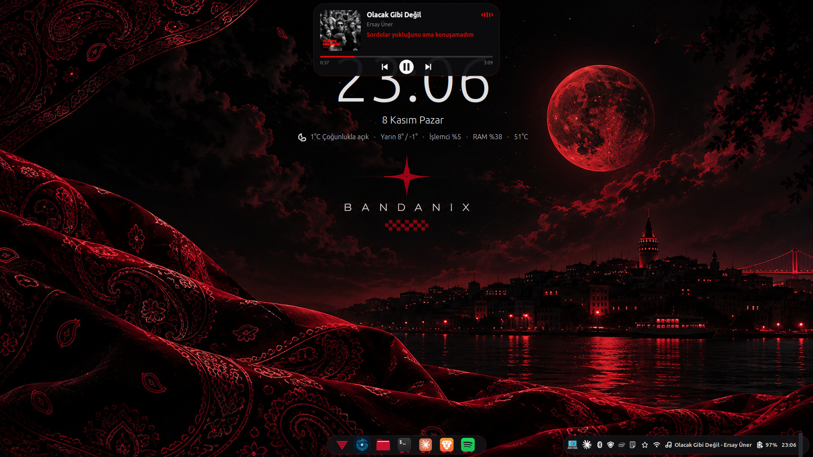
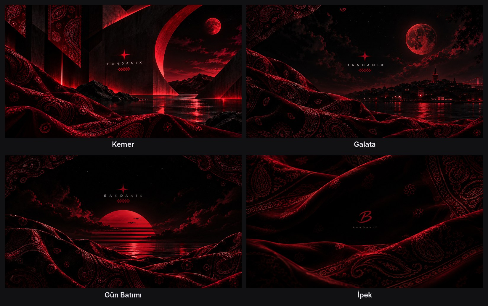
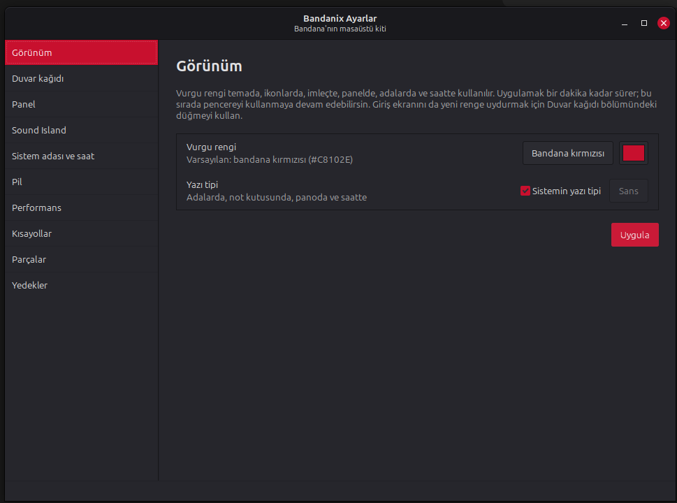

<div align="center">

```
 ____      _     _   _  ____      _     _   _  ___ __  __
| __ )    / \   | \ | ||  _ \    / \   | \ | ||_ _|\ \/ /
|  _ \   / _ \  |  \| || | | |  / _ \  |  \| | | |  \  /
| |_) | / ___ \ | |\  || |_| | / ___ \ | |\  | | |  /  \
|____/ /_/   \_\|_| \_||____/ /_/   \_\|_| \_||___|/_/\_\
```

**Linux Mint için Bandana'nın masaüstü kiti.**
Birbirine yakışan küçük araçlar. İstersen hepsini kur, istersen sadece beğendiklerini.

</div>

<p align="center">
  
</p>

## Parçalar

**Görünüm**

| Parça | Ne yapar |
|---|---|
| [**Cinnamon Teması**](cinnamon-tema/) | Mint-Y tabanlı koyu tema: pencereler, menüler, dosya yöneticisi ve panel bandana kırmızısı vurgularla. |
| [**İkonlar ve İmleç**](ikonlar/) | Bandana kırmızısı klasörler ve siyah gövdeli, kırmızı kenarlı fare imleci. |
| [**Duvar Kağıtları**](duvar-kagidi/) | Bandana kumaşı ve kırmızı gökyüzüyle bir seri: Kemer, Galata, Gün Batımı, İpek. |
| [**Panel Düzeni**](panel-duzeni/) | Paneli yüzen adalara çevirir: Windows 11 gibi ortada menü ve pencereler, sağda tepsi (ya da üç ada). |
| [**Giriş Ekranı**](giris-ekrani/) | Şifre yazdığın giriş ekranında duvar kağıdının bulanık hâli, Bandanix teması, ikonları ve imleci. |
| [**Açılış Ekranı**](acilis-ekrani/) | Açılışta ve kapanışta siyah zeminde BANDANIX ve ince kırmızı bir çizgi; GRUB menüsü de aynı görünümde. |
| [**Terminal**](terminal/) | İki satırlı prompt (git, Python ortamı, hata kodu), bandana kırmızısı renk şeması ve her yeni pencerede `bandanix-fetch`. |
| [**VS Code Teması**](vscode-tema/) | Bandanix Dark: nötr koyu arayüz, bandana kırmızısı vurgular ve sıcak tonlu kod renkleri. |
| [**Brave: Yeni Sekme ve Tema**](yeni-sekme/) | Yeni sekmede duvar kağıdı, büyük saat, arama ve en çok girdiğin 8 site; pencerede koyu bordo sekme şeridi. |
| [**Spotify Teması**](spotify-tema/) | Spotify'da koyu gri zemin; yeşil olan her şey bandana kırmızısı (Spicetify ile). |

**Adalar ve masaüstü**

| Parça | Ne yapar |
|---|---|
| [**Sound Island**](sound-island/) | Spotify ve diğer oynatıcılar için ekranın üstünde duran "şimdi çalıyor" hapı. Üzerine gelince kontrolleri ve senkron şarkı sözleriyle küçük bir oynatıcıya dönüşür; ses ya da parlaklık değişince kısa bir süre göstergeye dönüşür. |
| [**Sistem Adası**](sistem-adasi/) | Normalde görünmez; işlemci, sıcaklık, RAM ya da disk sınırı aşınca Sound Island'ın yanında beliren uyarı hapı. Üzerine gelince sorunun kaynağını gösterir. |
| [**Saat Widget'ı**](widget/) | Masaüstünün ortasında büyük ince saat, Türkçe tarih ve tek satırda hava durumu ile sistem bilgisi. Üzerine gelince 3 günlük tahmin. |

**Araçlar**

| Parça | Ne yapar |
|---|---|
| [**Hızlı Not**](not-kutusu/) | Super+N ile açılan küçük not kutusu: yaz, Enter'a bas, kaybolsun. Notlar tek bir Markdown dosyasında, yapılacak işler işaretlenebilir. |
| [**Pano Geçmişi**](pano/) | Super+V ile son kopyaladıkların: ara, seç, otomatik yapıştır. Sık kullandıklarını sabitle; şifre yöneticilerinden kopyalananlar saklanmaz. |
| [**Pil Sağlığı**](pil/) | Şarjı %80'de durdurarak pilin ömrünü uzatır, pil azalınca uyarır; gerektiğinde tek komutla bir seferlik tam şarj. |
| [**Güç Modları**](guc/) | Serin, Eco, Dengeli ve Turbo modları, fan modu ve Cooler Boost. Serin mod işlemcinin turbo'sunu kapatır: dizi izlerken bilgisayar serin ve sessiz kalır. |
| [**Bandanix Ayarlar**](ayarlar/) | Bütün parçaların ayarları tek pencerede: renk, duvar kağıdı, panel, adalar, pil, kısayollar; parça kurma ve kaldırma, yedekler. |

<p align="center">
  <br><br>
  <br><br>
  
</p>

## Kurulum

```bash
git clone https://github.com/furkansagsoyu/bandanix.git
cd bandanix
./install.sh
```

Kurulum bir menü açar: numara seç (`1 2`) ya da hepsi için `a` yaz.
Menüyü atlamak da mümkün:

```bash
./install.sh --all            # hepsini kur
./install.sh terminal         # sadece bir parçayı kur
```

Her şey yalnızca senin kullanıcın için kurulur (`~/.local`). Parçaların çoğu Mint'te zaten yüklü olan Python ve GTK ile çalışır; sadece adalar (Sound Island, Sistem Adası) Qt kullanır ve onu ortak tek bir Python ortamına kurar.
Eksik sistem paketleri `apt` ile kurulur (şifren sorulur). Sistem dosyalarına sadece Pil Sağlığı, Güç Modları, Giriş Ekranı ve Açılış Ekranı dokunur; hepsi kaldırılınca önceki hâline döner. Spotify Teması da Spotify'ın klasörüne yazma izni ister (Spicetify'ın kendi önerisi).

Kurduktan sonra her şeyi menüdeki **Bandanix Ayarlar** uygulamasından (ya da terminalde `bandanix`) yönetebilirsin.

<p align="center">
  
</p>

### Güncelleme

```bash
cd ~/bandanix
git pull
./install.sh            # değişen parçaları yeniden kur
```

## Ortak tema

Bütün parçalar tek bir dosyayı okur: `~/.config/bandanix/theme.toml`

```toml
[colors]
accent = "#C8102E"        # bandana kırmızısı

[fonts]
ui = ""                   # boş = sistemin yazı tipi
```

Bir kere değiştir, bütün parçalar uysun. Yeniden kurulum yaptığın değişiklikleri asla silmez.

Dosyayı elle düzenlemek yerine menüdeki **Bandanix Ayarlar** uygulamasını (ya da terminalde `bandanix`) da kullanabilirsin.

## Yedekleme

Bandanix masaüstüne dokunmadan önce her kurulumda ayarlarının bir anlık görüntüsünü alır. İlk yedek **"orijinal"** olarak işaretlenir ve hiçbir zaman otomatik silinmez; Bandanix öncesi masaüstüne dönüş yolu hep açık kalır.

```bash
bandanix-yedek liste                  # bütün yedekler
bandanix-yedek al "yeni panel"        # elle yedek al
bandanix-yedek fark orijinal          # o yedekten bu yana neler değişmiş
bandanix-yedek geri-yukle orijinal    # masaüstünü o ana döndür
bandanix-yedek disa-aktar 3           # tek bir .tar.gz dosyası yap
bandanix-yedek ice-aktar dosya.tar.gz # başka bilgisayardan gelen yedeği ekle
```

- Yedekler Cinnamon ve masaüstü ayarlarını (panel, uygulamacıklar, kısayollar, tema, yazı tipleri, duvar kağıdı, Nemo, terminal profilleri), `.bashrc`'yi ve uygulamacık ayarlarını içerir. Genelde 1 MB'ın altındadır.
- Her geri yüklemeden önce mevcut hâlin de yedeklenir, yani geri yüklemenin de geri dönüşü vardır.
- Bir parçayı kaldırınca sadece o parçanın değiştirdiği ayarlar eski hâline döner; senin başka ayarlarına dokunulmaz.
- İçe aktarmada dosya yollarındaki kullanıcı adı yeni bilgisayara göre düzeltilir.
- Saklama: orijinal ve elle alınanlar kalıcı, otomatik yedeklerin son 5'i, geri yükleme öncesi yedeklerin son 3'ü tutulur.

## Kaldırma

```bash
./uninstall.sh                  # menü
./uninstall.sh --all            # hepsini kaldır, tema dosyası kalsın
./uninstall.sh --all --purge    # tema dosyası dahil her şeyi kaldır
```

Kaldırma işlemi masaüstü yedeklerini ve `bandanix-yedek` komutunu **silmez**, böylece Bandanix'i kaldırdıktan sonra da orijinal masaüstüne dönebilirsin.

## Gereksinimler

Linux Mint 22 Cinnamon (X11) için yazıldı ve orada test edildi. Tema, panel, saat widget'ı, kısayollar ve ses göstergesi Cinnamon'a özeldir; Sound Island, Terminal ve Pil Sağlığı başka X11 masaüstlerinde de çalışabilir. Wayland desteklenmez.

## Notlar

Furkan Sağsoyu (Bandana) tarafından, bir yapay zekâ asistanının (Claude) yardımıyla geliştirildi.
Spotify, Apple ya da Linux Mint ile bir bağlantısı yoktur.

## Lisans

MIT
