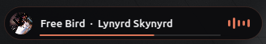
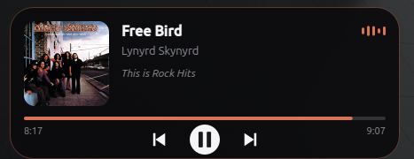

<div align="center">

```
 ____      _     _   _  ____      _     _   _  ___ __  __
| __ )    / \   | \ | ||  _ \    / \   | \ | ||_ _|\ \/ /
|  _ \   / _ \  |  \| || | | |  / _ \  |  \| | | |  \  /
| |_) | / ___ \ | |\  || |_| | / ___ \ | |\  | | |  /  \
|____/ /_/   \_\|_| \_||____/ /_/   \_\|_| \_||___|/_/\_\
```

**Linux Mint için Bandana'nın masaüstü kiti.**
Birbirine yakışan küçük araçlar. İstersen hepsini kur, istersen sadece beğendiklerini.

</div>

## Parçalar

| Parça | Ne yapar |
|---|---|
| [**Sound Island**](sound-island/) | Spotify ve diğer oynatıcılar için ekranın üstünde duran "şimdi çalıyor" hapı. Üzerine gelince kontrolleri ve senkron şarkı sözleriyle küçük bir oynatıcıya dönüşür. |
| [**Cinnamon Teması**](cinnamon-tema/) | Mint-Y tabanlı koyu tema: pencereler, menüler, dosya yöneticisi ve panel bandana kırmızısı vurgularla. |
| [**İkonlar ve İmleç**](ikonlar/) | Bandana kırmızısı klasörler ve siyah gövdeli, kırmızı kenarlı fare imleci. |
| [**Terminal**](terminal/) | İki satırlı prompt (git, Python ortamı, hata kodu), bandana kırmızısı renk şeması ve her yeni pencerede `bandanix-fetch`. |

<p align="center">
  <br><br>
  
</p>

Yeni parçalar yolda.

## Kurulum

```bash
git clone https://github.com/furkansagsoyu/bandanix.git
cd bandanix
./install.sh
```

Kurulum bir menü açar: numara seç (`1 2`) ya da hepsi için `a` yaz.
Menüyü atlamak da mümkün:

```bash
./install.sh --all            # hepsini kur
./install.sh terminal         # sadece bir parçayı kur
```

Her şey yalnızca senin kullanıcın için kurulur (`~/.local`), her parça kendi Python ortamında çalışır.
Eksik sistem paketleri `apt` ile kurulur (şifren sorulur).

## Ortak tema

Bütün parçalar tek bir dosyayı okur: `~/.config/bandanix/theme.toml`

```toml
[colors]
accent = "#C8102E"        # bandana kırmızısı

[fonts]
ui = ""                   # boş = sistemin yazı tipi
```

Bir kere değiştir, bütün parçalar uysun. Yeniden kurulum yaptığın değişiklikleri asla silmez.

## Yedekleme

Bandanix masaüstüne dokunmadan önce her kurulumda ayarlarının bir anlık görüntüsünü alır. İlk yedek **"orijinal"** olarak işaretlenir ve hiçbir zaman otomatik silinmez; Bandanix öncesi masaüstüne dönüş yolu hep açık kalır.

```bash
bandanix-yedek liste                  # bütün yedekler
bandanix-yedek al "yeni panel"        # elle yedek al
bandanix-yedek fark orijinal          # o yedekten bu yana neler değişmiş
bandanix-yedek geri-yukle orijinal    # masaüstünü o ana döndür
bandanix-yedek disa-aktar 3           # tek bir .tar.gz dosyası yap
bandanix-yedek ice-aktar dosya.tar.gz # başka bilgisayardan gelen yedeği ekle
```

- Yedekler Cinnamon ve masaüstü ayarlarını (panel, uygulamacıklar, kısayollar, tema, yazı tipleri, duvar kağıdı, Nemo, terminal profilleri), `.bashrc`'yi ve uygulamacık ayarlarını içerir. Genelde 1 MB'ın altındadır.
- Her geri yüklemeden önce mevcut hâlin de yedeklenir, yani geri yüklemenin de geri dönüşü vardır.
- Bir parçayı kaldırınca sadece o parçanın değiştirdiği ayarlar eski hâline döner; senin başka ayarlarına dokunulmaz.
- İçe aktarmada dosya yollarındaki kullanıcı adı yeni bilgisayara göre düzeltilir.
- Saklama: orijinal ve elle alınanlar kalıcı, otomatik yedeklerin son 5'i, geri yükleme öncesi yedeklerin son 3'ü tutulur.

## Kaldırma

```bash
./uninstall.sh                  # menü
./uninstall.sh --all            # hepsini kaldır, tema dosyası kalsın
./uninstall.sh --all --purge    # tema dosyası dahil her şeyi kaldır
```

Kaldırma işlemi masaüstü yedeklerini ve `bandanix-yedek` komutunu **silmez**, böylece Bandanix'i kaldırdıktan sonra da orijinal masaüstüne dönebilirsin.

## Test edildiği sistem

Linux Mint 22 (Cinnamon, X11). X11 kullanan diğer Debian/Ubuntu tabanlı masaüstlerinde de çalışması beklenir.

## Notlar

Furkan Sağsoyu (Bandana) tarafından, bir yapay zekâ asistanının (Claude) yardımıyla geliştirildi.
Spotify, Apple ya da Linux Mint ile bir bağlantısı yoktur.

## Lisans

MIT
