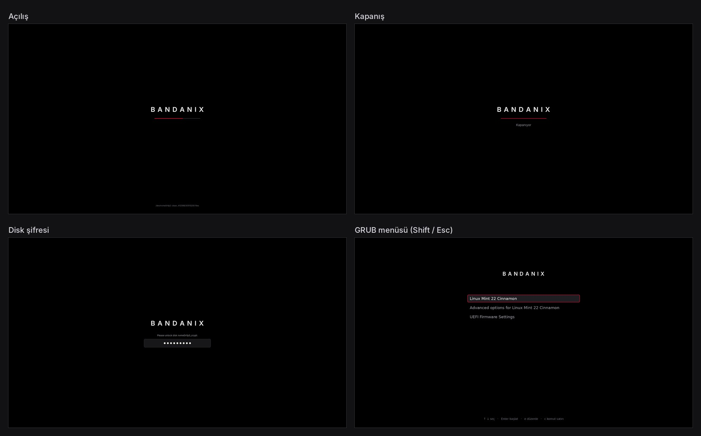

# Açılış Ekranı

Bilgisayar açılırken ve kapanırken Mint logosunun yerine siyah zeminde **BANDANIX** ve altında ince bandana kırmızısı bir çizgi görünür. GRUB'un sistem seçme menüsü de aynı görünüme gelir.



## Kurulum

```bash
./install.sh acilis-ekrani
```

Sistem dosyalarına yazdığı için bir kez şifre sorar. Açılış dosyası (initramfs) yeniden üretildiği için kurulum 1 dakika kadar sürer. Arka planda hiçbir şey çalışmaz.

## Ne görürsün

- **Açılış:** Çizgi, sistemin bildirdiği ilerlemeye göre dolar. Bir süre ilerleme gelmezse yavaşça soluklaşıp parlar, ekran donmuş görünmez.
- **Kapanış ve yeniden başlatma:** Çizgi yavaşça nefes alır, altında "Kapanıyor" ya da "Yeniden başlatılıyor" yazar.
- **Şifreli disk:** Aynı ekranda bir şifre kutusu çıkar, yazdığın her harf bir nokta olur.
- **Sistem mesajları** (disk denetimi gibi) en altta küçük gri yazıyla görünür.

## GRUB menüsü

Mint, bilgisayarda tek sistem varken menüyü gizler ve doğrudan açılır. Bu parça bunu değiştirmez. Menüyü görmek için açılışta **Shift**'e basılı tut ya da (UEFI'de) **Esc**'ye bir kez bas. Esc'ye birkaç kez basarsan `grub>` komut satırına düşebilirsin; orada `normal` yazıp Enter'a bas.

Ana `/etc/default/grub` dosyasına dokunulmaz; tema ayarı ayrı küçük bir dosyadadır: `/etc/default/grub.d/99-bandanix.cfg`.

## Komut

```bash
bandanix-acilis               # açılış ekranı ve GRUB teması kurulu mu, menü gizli mi
bandanix-acilis dene          # açılış ekranını 15 saniyeliğine bir pencerede göster
bandanix-acilis dene kapanis  # kapanış ekranını göster
```

`dene` için `plymouth-x11` paketi gerekir: `sudo apt install plymouth-x11`

## Kaldırma

```bash
./acilis-ekrani/uninstall.sh
```

Mint'in kendi açılış ekranı ve GRUB teması geri gelir, açılış dosyası yeniden üretilir.

## Sorun olursa

- **Açılışta ekran yerine yazılar akıyorsa:** Çekirdek satırında `splash` yoktur; `bandanix-acilis` bunu söyler. Mint'te varsayılan olarak vardır.
- **Tema bozulursa** açılış bozulmaz; Plymouth düz yazılı ekrana düşer. Kaldırma komutu her şeyi geri alır.
- Resimler `cizim.py` ile üretildi. Değiştirmek istersen `python3 acilis-ekrani/cizim.py onizleme`, sonra yeniden kur.
