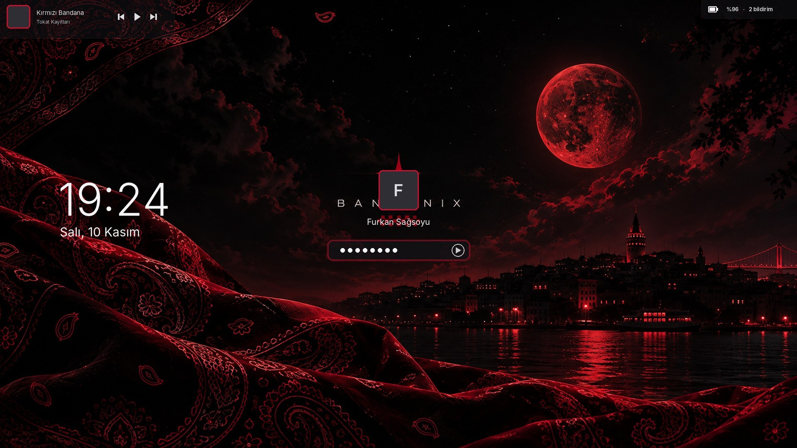

# Cinnamon Teması 🎨

*[Bandanix](../README.md) kitinin bir parçası.*

Pencereleri, menüleri, dosya yöneticisini, Cinnamon panelini ve kilit ekranını Bandanix renklerine çeviren koyu tema.

## Nasıl çalışır

Tema sıfırdan çizilmiyor: kurulum, Mint'in kendi **Mint-Y-Dark-Red** temasını kopyalayıp renklerini Bandanix paletine taşıyor ve sonucu `~/.themes/Bandanix` klasörüne koyuyor.

- Sistem dosyalarına dokunulmaz, şifre gerekmez
- Mint uygulamalarıyla birebir uyumlu kalır
- Derleme aracı gerekmez; üretim birkaç saniye sürer
- Kırmızılar bandana kırmızısına, koyu griler Bandanix tonlarına geçer. Mint-Y'nin yeşil boyadığı vurgulu düğmeler ("Uygula", "Kur", "Kaydet") vurgu rengini alır; başka renklere dokunulmaz.

## Kapsam

GTK3 ve GTK2 uygulamaları, Cinnamon (panel, menü, bildirimler, Alt+Tab, göstergeler) ve GTK4/libadwaita uygulamalarının vurgu rengi.

Pencere kenarlıkları değiştirilmez: Mint-Y'nin bütün renk varyantları ortak "Mint-Y" kenarlığını kullanır, Bandanix de onu kullanmaya devam eder. Başlık çubuğunu kendisi çizen uygulamalarda (çoğu GTK3 uygulaması) başlık ve düğmeler Bandanix renklerini alır.

## Kilit ekranı



*Temanın renkleriyle çizilmiş bir önizleme; Galata duvar kağıdındaki BANDANIX yazısı gerçek ekranda da kullanıcı resminin arkasında kalır.*

Super+L ile kilitlediğinde:

- Saat büyük ve ince yazıyla, altında "Salı, 10 Kasım". Yazı tipi `theme.toml` içindeki `fonts.ui`; boşsa Ubuntu.
- Saat yerinde durur, Cinnamon'daki gibi ekranda gezinmez. Cinnamon'un sabit yeri sol ortadır, ortaya alınamaz.
- Şifre kutusu koyu ve yuvarlak köşeli; yazarken kenarı vurgu renginde yanar. Kullanıcı resmi ve albüm kapağı vurgu rengi çerçeveli.
- Çalan şarkı sol üstte; kilit ekranından durdurup geçebilirsin.

Arka plan masaüstü duvar kağıdının kendisidir. Mevcut Cinnamon kilit ekranında bulanıklaştırma ya da ayrı bir resim mümkün değil. Linux Mint 23'te gelecek yeni kilit ekranında bu bölüm yeniden ele alınacak.

Tema kaldırılınca kilit ekranı ayarları da eski hâline döner.

## Diğer uygulamalar

VS Code, Spotify, Discord gibi Electron uygulamaları kendi görünümlerini kullanır ve bu temadan etkilenmez. VS Code, Brave ve Spotify için ayrı Bandanix parçaları var.

## Renkler

| Kullanım | Renk |
|---|---|
| Panel, en koyu zemin | `#121214` |
| Pencere zemini | `#17171A` |
| Kenar çubuğu, kartlar | `#1C1C1F` |
| Metin | `#E8E6E3` |
| Vurgu | `#C8102E` |

Vurgu rengi `~/.config/bandanix/theme.toml` dosyasındaki `accent` değerinden okunur. En kolayı Bandanix Ayarlar → Görünüm: renk seçip "Uygula"ya basınca tema, ikonlar, imleç ve panel birlikte yeniden üretilir. Sadece temayı yeniden üretmek için:

```bash
./install.sh cinnamon-tema
```

## Kurulum ve kaldırma

```bash
./install.sh cinnamon-tema
./uninstall.sh cinnamon-tema
```

Kurulum temayı ürettikten sonra uygulansın mı diye sorar. Uygularken değiştirdiği her ayarın eski değerini `bandanix-yedek` ile saklar; kaldırınca yalnızca bu ayarlar eski hâline döner.

Mint bir güncellemeyle Mint-Y'yi yenilerse aynı kurulum komutu Bandanix'i yeni sürümün üzerine tekrar üretir.

## Lisans

Bu tema Linux Mint'in [mint-themes](https://github.com/linuxmint/mint-themes) projesinden türetilir; üretilen tema dosyaları o projenin lisansına tabidir. Bandanix'in kendi kodu MIT lisanslıdır.
