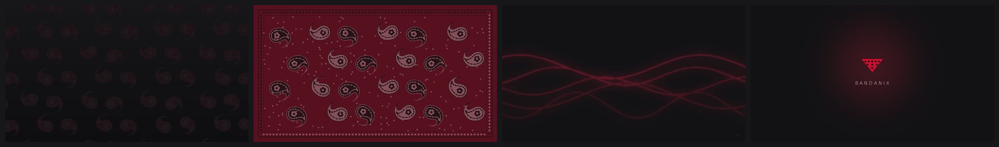

# Duvar Kağıtları 🖼️

*[Bandanix](../README.md) kitinin bir parçası.*

İnternetten indirilmiş resim yok: dört stil de kodla, senin ekran çözünürlüğünde çiziliyor.

<p align="center">
  
</p>

| Stil | Görünüm |
|---|---|
| **Gece** (varsayılan) | Koyu zeminde ton-sur-ton paisley deseni; pencerelerin arkasında neredeyse sadece doku |
| **Bandana** | Gerçek bir bandana düzeni (bordür, noktalı kenar, paisleyler), soluk ve mat tonlarda |
| **Dalga** | Desensiz; koyu zeminde akışkan kırmızı ışık çizgileri |
| **Logo** | Ortada bandana işareti ve BANDANIX yazısı |

## Günün saatine göre

Her stilin dört tonu var: **sabah** (06–11), **öğle** (11–17), **akşam** (17–21) ve **gece** (21–06). Saat başında ve oturum açılışında çalışan küçük bir zamanlayıcı doğru tonu seçer; arada hiçbir şey çalışmaz.

Cinnamon'dan kendin başka bir duvar kağıdı seçersen zamanlayıcı ona dokunmaz.

## Komutlar

```bash
bandanix-duvar bandana     # stil seç: gece, bandana, dalga ya da logo
bandanix-duvar durum       # şu an ne seçili
bandanix-duvar kapat       # zamana göre değişimi durdur
bandanix-duvar ac          # tekrar aç
```

Seçtiğin stil `~/.config/bandanix/theme.toml` dosyasındaki `[duvar-kagidi]` bölümüne kaydedilir.

## Kurulum ve kaldırma

```bash
./install.sh duvar-kagidi
./uninstall.sh duvar-kagidi
```

Kurulum ekran çözünürlüğünü algılar (birden fazla monitörde en büyüğünü) ve 16 resmi (4 stil × 4 zaman) birkaç saniyede üretir. Vurgu rengini değiştirdiysen ya da ekranın değiştiyse aynı komutla yeniden üretebilirsin.

Uygularken mevcut duvar kağıdın `bandanix-yedek` ile saklanır; kaldırınca zamanlayıcı silinir ve eski duvar kağıdın geri gelir.
