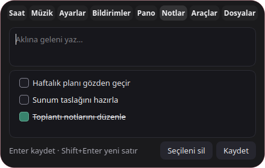

# Bandanix Adası

*[Bandanix](../README.md) kitinin bir parçası.*

Ekranın üst ortasında sürekli duran Bandanix adası. Boşta saati gösterir. Müzik çalarken kompakt görünümde albüm kapağı ve ses çubukları bulunur.

Üzerine gelince ada açılır. Sekmelere tıklayarak veya fare tekerleğiyle sırayla geçebilirsin.

- **Saat** günün tarihini ve hava durumunu gösterir. Şehri Bandanix Ayarları → Sistem adası ve saat bölümünden seçebilirsin. Tarihe basarak aylık takvimi açabilirsin. Saat widget'ı da kuruluysa iki bileşen aynı hava durumu verisini kullanır.
- **Müzik** Spotify ve diğer [MPRIS](https://specifications.freedesktop.org/mpris-spec/latest/) oynatıcılarının kapağını, oynatma kontrollerini, ilerlemesini ve varsa senkron şarkı sözlerini gösterir. `cava` yalnızca müzik çalarken çalışır.
- **Ayarlar** sesi ve desteklenen ekranlarda parlaklığı değiştirir. Bandanix Ayarları ve Cinnamon Sistem Ayarları buradan açılır.
- **Bildirimler** oturumdaki standart masaüstü uygulama bildirimlerini gösterir. Yeni bildirim geldiğinde kompakt adada bir nokta belirir. Son 50 bildirim uygulama kapanana kadar bellekte tutulur ve sekmeden temizlenebilir. Ada çalışırken Cinnamon’un bildirim açılır pencereleri kapanır. Adadan çıkınca önceki ayar geri yüklenir.

- **Pano** geçmişi kartlarda gösterir. Ara, bir kartı seç ve Enter ile önceki pencereye yapıştır. Sağ tıkla sabitleyebilir veya silebilirsin. `Super+V` doğrudan bu sekmeyi açar.
- **Notlar** aynı Markdown dosyasındaki hızlı notları ve yapılacakları gösterir. Enter ile kaydet, Shift+Enter ile yeni satır ekle. Kutuyu işaretleyerek notu tamamla veya işareti kaldırarak yeniden aç. Notu seçip **Seçileni sil** düğmesiyle ya da `Delete` ile kaldır. `Super+N` doğrudan bu sekmeyi açar.

- **Araçlar** odak sayacını, alan ekran görüntüsünü ve ekran kaydını açar. Kayıt X11’de GStreamer ile sessiz WebM olarak Videolar klasörüne kaydedilir. Ada kayıt sırasında kırmızı nokta gösterir. GStreamer veya `gnome-screenshot` yoksa ilgili düğme kapanır.
- **Dosyalar** adaya sürüklediğin yerel dosyaların yollarını saklar. Dosyayı tıklayıp açabilir veya başka bir uygulamaya sürükleyebilirsin. Raftan kaldırmak dosyayı silmez.



Kısayola tekrar basınca ya da Esc ile ada küçülür. Bu iki sekme için `pano` ve `not-kutusu` bileşenlerini de kur. Ada kapalıyken kısayollar kendi pencerelerini açar.

Ses veya parlaklık tuşlarını kullanınca ada kısa süreliğine göstergeye dönüşür. Adadan çıkmak için sağ tık → Çıkış.

## Kurulum

Bandanix klasöründe:

```bash
./install.sh sound-island pano not-kutusu
```

Kurulum adayı bir oturum bileşeni olarak ekler ve önceki uygulama menüsü kaydını temizler. Oturum açılışında başlayabilir. Elle başlatmak için `bandanix-ada` komutunu kullan. Terminali kapatsan da ada çalışmaya devam eder.

Başka bir oynatıcı için `--player` kullan (isimleri `playerctl -l` gösterir):

```bash
bandanix-ada --player vlc
```

## Ayarlar

`~/.config/bandanix/theme.toml` dosyasında:

```toml
[sound-island]
follow_cover = true       # vurgu rengini albüm kapağından al
bars = "auto"             # "auto" = cava ile gerçek ses, "simulated" = temsili çubuklar
gosterge = true           # ses ve parlaklık göstergesi (false = Cinnamon'ın kendi göstergesi)
```

Bu ayarlar Bandanix Ayarlar → Bandanix Adası'dan da değiştirilebilir; orada ada kendiliğinden yeniden başlar. Dosyayı elle düzenlediysen adayı yeniden başlat; `gosterge` ayarını değiştirdiysen `./install.sh sound-island` komutunu çalıştır.

Not: cava bilgisayarın çaldığı **bütün** sesi dinler, sadece Spotify'ı değil. Aynı anda bir video açıksa çubuklar onun sesine de tepki verir.

## Sorun giderme

Ada beklenmedik şekilde kapanırsa başlatıcı yeniden açmayı dener. Son oturumun hata kaydı `~/.local/state/bandanix/ada-son-oturum.log` dosyasındadır (`XDG_STATE_HOME` ayarlıysa onun altında).

Şarkı sözleri gelmiyorsa adayı hata ayıklama modunda başlat, terminalde her söz isteğinin sonucu yazılır:

```bash
SOUND_ISLAND_DEBUG=1 bandanix-ada
```

## Kaynak koddan çalıştırma (geliştirme)

```bash
sudo apt install playerctl cava python3-venv libxcb-cursor0
cd sound-island
python3 -m venv .venv
source .venv/bin/activate
pip install -r ../ortak/ada/requirements.txt
python -m unittest discover tests
PYTHONPATH=../ortak/ada python -m sound_island
```

Qt kurulumu diğer Bandanix adalarıyla (Sistem adası) ortaktır: `~/.local/share/bandanix/ada`. Hap çizimi ve adaların yan yana dizilmesi `ortak/ada` klasöründedir.

## Yol haritası

- [x] Gerçek sese tepki veren çubuklar (cava)
- [x] Ses ve parlaklık göstergesi
- [x] Ayarlar penceresi (Bandanix Ayarlar)
- [ ] Konum ve boyut seçenekleri

Şarkı sözleri topluluk tarafından oluşturulan LRCLIB veritabanından gelir.
