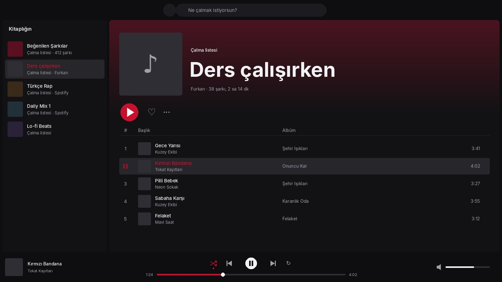

# Spotify Teması

Spotify'da Bandanix renkleri: koyu gri zemin, daha koyu kenar çubuğu, Spotify'ın yeşil boyadığı her şey (oynat düğmesi, beğen kalbi, karıştır, sürüklerken ilerleme çubuğu) bandana kırmızısı. Düzen Spotify'ın kendi düzenidir.



*Resim temanın renkleriyle çizilmiş bir önizlemedir; şarkı ve sanatçı adları uydurmadır.*

## Kurulum

```bash
./install.sh spotify-tema
```

Kurulum şunları yapar:

1. Spotify'ın nasıl kurulduğuna bakar: deb paketi ya da Flatpak olabilir, Snap desteklenmez (aşağıya bak).
2. [Spicetify](https://spicetify.app)'ı GitHub'daki resmî sürümünden `~/.spicetify` klasörüne kurar. Zaten kuruluysa onu kullanır. `~/.bashrc` dosyana dokunmaz.
3. Spotify'ın klasörüne yazabilmek için bir kez şifre sorar. Bu, Spicetify'ın kendi önerdiği izin ayarıdır: `chmod a+wr`.
4. Temayı uygular. Spotify açıksa yeniden başlar.

Spotify'ı daha önce hiç açmadıysan önce aç, giriş yap, 1 dakika bekle ve kapat; Spicetify'ın ihtiyaç duyduğu dosyalar o zaman oluşur.

## Spotify güncellenince

Spotify her güncellemede kendi dosyalarını yeniler ve tema kalkar. Oturum açılışında bir kez sürüm kontrolü yapılır:

- Sürüm değiştiyse tema kendiliğinden yeniden uygulanır. Spotify o sırada açıksa yeniden başlatınca görünür.
- Güncelleme klasör iznini de sıfırladıysa bir bildirim gelir; terminalde `bandanix-spotify uygula` çalıştırırsın, şifreni sorar.

Arka planda sürekli çalışan bir şey yoktur; kontrol 1 saniye sürer ve biter.

## Komut

```bash
bandanix-spotify            # Spotify nasıl kurulu, Spicetify sürümü, tema açık mı
bandanix-spotify uygula     # temayı (yeniden) uygula
bandanix-spotify geri       # Spotify'ın kendi görünümüne dön (Bandanix kurulu kalır)
```

Renkler `tema/Bandanix/color.ini`, küçük dokunuşlar `tema/Bandanix/user.css` içinde. Değiştirdikten sonra: `./install.sh spotify-tema`.

## Kaldırma

```bash
./spotify-tema/uninstall.sh
```

Spotify'ı orijinal hâline döndürür, klasör izinlerini geri alır (şifre sorabilir), oturum kontrolünü siler. Spicetify'ı bu parça kurduysa onu da kaldırır.

## Snap'ten geçiş

Snap uygulamaları değiştirilemediği için Spicetify Snap'teki Spotify'da çalışmaz. En kolay yol Flatpak sürümüne geçmek; Mint'te Flathub hazır gelir:

```bash
sudo snap remove spotify
flatpak install flathub com.spotify.Client
```

Spotify'ı bir kez açıp giriş yap, sonra `./install.sh spotify-tema`. Deb sürümünü tercih edersen güncel kurulum komutları Spotify'ın sayfasında: <https://www.spotify.com/tr/download/linux/>

## Notlar

- Spotify yeni bir sürüm çıkardığında Spicetify'ın uyumlu sürümü birkaç gün gecikebilir. Tema o arada uygulanamazsa Spotify kendi görünümüyle çalışmaya devam eder.
- Sound Island ve ses göstergesi bu temadan etkilenmez.
