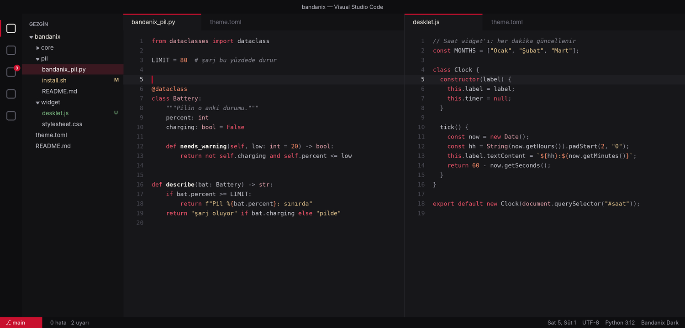

# VS Code Teması: Bandanix Dark

Kod yazarken de masaüstüyle aynı renkler: nötr koyu arayüz, bandana kırmızısı vurgular ve sıcak tek aileden bir kod paleti.



## Kurulum

```bash
./install.sh vscode-tema
```

Kurulum temayı tek bir `.vsix` dosyasına paketler ve VS Code'un kendi komutuyla kurar (`code --install-extension`). VSCodium ya da VS Code Insiders kuruluysa onlara da kurar. Node ya da başka bir araç gerekmez.

Temayı sen seçersin: VS Code'da `Ctrl+K`, ardından `Ctrl+T`, listeden **Bandanix Dark**. Ayar dosyana (`settings.json`) dokunulmaz.

## Renkler

| Ne | Renk | Zemine karşı kontrast |
| --- | --- | --- |
| Zemin | `#17171A` | |
| Düz yazı | `#D8D8DE` | 12,6 |
| Anahtar kelimeler (`def`, `return`, `const`) | `#F2546B` | 5,3 |
| Metinler | `#E3C58E` | 10,8 |
| Sayılar, sabitler, dekoratörler | `#FF8F6B` | 8,0 |
| Tipler ve sınıflar | `#E5A3AE` | 8,7 |
| Fonksiyon adları (kalın) | `#F7F3EC` | 16,2 |
| Değişkenler | `#C9C9D1` | 10,9 |
| Yorumlar (eğik) | `#85858F` | 4,9 |

Arayüzdeki vurgu (aktif sekme çizgisi, imleç, rozetler, durum çubuğunun sol köşesi) bandana kırmızısıdır: `#C8102E`. Bu renk sabittir, `theme.toml` içindeki vurgu rengini izlemez. Gömülü terminal, Bandanix terminaliyle aynı 16 rengi kullanır.

Kontrast 4,5 ve üstü rahat okunur demektir; kodda kullanılan her renk bu sınırın üstündedir (testler bunu denetler).

## Bir rengi değiştirmek

Renkler `eklenti/themes/bandanix-dark-color-theme.json` dosyasındadır. Değiştirdikten sonra yeniden kur ve VS Code'da `Ctrl+Shift+P` → "Reload Window" de:

```bash
./install.sh vscode-tema
```

## Kaldırma

```bash
./vscode-tema/uninstall.sh
```

Eklentiyi kaldırır. Seçili tema Bandanix Dark ise VS Code kendi varsayılan temasına döner.

## Notlar

- Flatpak ile kurulmuş VS Code'da `code` komutu olmadığı için kurulum onu bulamaz. O durumda paketi elle kur: `python3 vscode-tema/paket.py vscode-tema/eklenti /tmp/bandanix-dark.vsix`, sonra VS Code'da `Ctrl+Shift+P` → "Install from VSIX".
- Tema arka planda hiçbir şey çalıştırmaz; yalnızca bir renk dosyasıdır.
