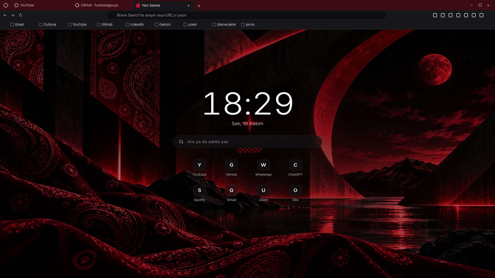

# Brave: Yeni Sekme ve Tema

Brave'de yeni sekme açınca Bandanix duvar kağıdı, büyük saat, arama kutusu ve en çok girdiğin 8 site. Pencerenin kendisi de Bandanix renklerinde: koyu bordo sekme şeridi, koyu gri araç çubuğu.




*İkinci resim temanın renkleriyle çizilmiş bir önizlemedir; Brave'in gerçek ekranı ayrıntılarda farklı olabilir.*

## Kurulum

```bash
./install.sh yeni-sekme
```

Brave, yeni sekmeye başka bir sayfanın konmasına yalnızca eklentiyle izin veriyor ve kendi yazdığın bir eklentiyi elle yüklemeni istiyor. Tema ile yeni sekme aynı eklentide olamadığı için iki klasör var. Kurulum `brave://extensions` sayfasını açar ve yalnızca henüz yüklenmemiş klasörleri yazar. Her klasör için bir kez:

1. Sağ üstteki **Geliştirici modu**nu aç.
2. **Paketlenmemiş öğe yükle**ye bas.
3. Klasör penceresinde `Ctrl+L`'ye bas, yolu yaz ve **Seç**e bas:
   - yeni sekme: `~/.local/share/bandanix/yeni-sekme/eklenti`
   - tema: `~/.local/share/bandanix/yeni-sekme/tema`

İlk yeni sekmede Brave "bu sayfayı bir eklenti değiştirdi" diye sorarsa **Değişiklikleri koru** de.

Sonraki güncellemeler aynı klasöre yazılır; Brave onları bir sonraki yeni sekmede kendiliğinden gösterir, tekrar yüklemen gerekmez.

## Sayfada ne var

- **Saat ve tarih**, dakikada bir güncellenir.
- **Arama kutusu:** Brave'de seçili arama motorunda arar. `github.com` gibi bir adres yazarsan doğrudan oraya gider. Yeni sekme açılınca imleç Brave'in adres çubuğunda durur; kutuyu kullanmak için tıkla. Bu Brave'in kuralıdır, eklentiden değiştirilemez.
- **Kısayollar:** Brave'in "en çok girilenler" listesinden ilk 8 site. Adı sitenin kendisinden gelir (gemini.google.com → Gemini, uzem.gop.edu.tr → Uzem). Üstüne gelince köşede bir × çıkar; tıklarsan o site bir daha gösterilmez, yerine sıradaki gelir.
- **Arka plan:** Masaüstündeki duvar kağıdı, ortası hafif karartılmış. `bandanix-duvar` ile ya da Ayarlar'dan duvar kağıdını değiştirince yeni sekme de değişir.
- **Renk ve yazı tipi:** `theme.toml` içindeki `accent` ve `fonts.ui`. Değiştirince `bandanix-sekme guncelle`.

Sayfa internete bağlanmaz, arka planda hiçbir şey çalışmaz.

En alttaki "Bandanix Yeni Sekme · Brave'u özelleştir" şeridini Brave ekler; eklentiden kaldırılamaz. Sağ tıklayınca "gizle" seçeneği çıkıyorsa oradan kapatabilirsin.

## Tema

- Sekme şeridi koyu bordo (`#3A0B15`), pencere arka plandayken biraz daha koyu; gizli pencerelerde en koyusu.
- Aktif sekme ve araç çubuğu koyu gri (`#17171A`), adres çubuğu `#0E0E10`.
- Renkler sabittir, `theme.toml`'u izlemez. Brave'in kenar çubuğu ve menüleri temayı izlemez.

## Komut

```bash
bandanix-sekme             # yeni sekme ve tema Brave'de yüklü mü, hangi duvar kağıdı görünüyor
bandanix-sekme guncelle    # renkleri theme.toml'dan, arka planı masaüstü duvar kağıdından yeniden al
bandanix-sekme ac          # Brave'de eklentiler sayfasını aç
bandanix-sekme ac tema     # Brave'de görünüm ayarlarını aç
```

Duvar kağıdını Cinnamon'ın kendi ayarlarından değiştirdiysen yeni sekme bunu kendiliğinden görmez; `bandanix-sekme guncelle` çalıştır.

## Kaldırma

```bash
./yeni-sekme/uninstall.sh
```

Dosyaları siler ve Brave'de iki sayfa açar. `brave://extensions` sayfasında **Bandanix Yeni Sekme** kartındaki **Kaldır**'a, `brave://settings/appearance` sayfasında temanın yanındaki **Varsayılana sıfırla**'ya basarsın.

## Notlar

- Gizlediğin siteleri geri getirmek için eklentiyi `brave://extensions` sayfasından kaldırıp yeniden yükle.
- Brave Flatpak ile kuruluysa eklenti klasörünü göremeyebilir; Mint'te Brave'in kendi deposundan kurulmuş hâli önerilir.
