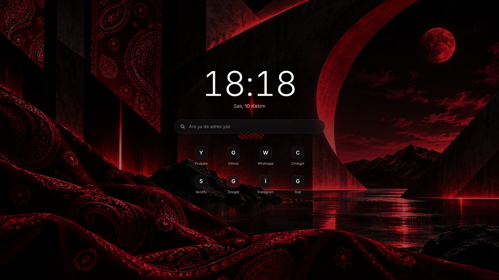

# Yeni Sekme

Brave'de yeni sekme açınca Bandanix duvar kağıdı, büyük saat, arama kutusu ve en çok girdiğin 8 site.



## Kurulum

```bash
./install.sh yeni-sekme
```

Brave, yeni sekmeye başka bir sayfanın konmasına yalnızca eklentiyle izin veriyor ve kendi yazdığın bir eklentiyi elle yüklemeni istiyor. Kurulum `brave://extensions` sayfasını açar. Orada bir kez şunları yaparsın:

1. Sağ üstteki **Geliştirici modu**nu aç.
2. **Paketlenmemiş öğe yükle**ye bas.
3. Klasör penceresinde `Ctrl+L`'ye bas, şu yolu yaz ve **Seç**e bas: `~/.local/share/bandanix/yeni-sekme/eklenti`

İlk yeni sekmede Brave "bu sayfayı bir eklenti değiştirdi" diye sorarsa **Değişiklikleri koru** de.

Sonraki güncellemeler aynı klasöre yazılır; Brave onları bir sonraki yeni sekmede kendiliğinden gösterir, tekrar yüklemen gerekmez.

## Sayfada ne var

- **Saat ve tarih**, dakikada bir güncellenir.
- **Arama kutusu:** Brave'de seçili arama motorunda arar. `github.com` gibi bir adres yazarsan doğrudan oraya gider. Yeni sekme açılınca imleç Brave'in adres çubuğunda durur; kutuyu kullanmak için tıkla. Bu Brave'in kuralıdır, eklentiden değiştirilemez.
- **Kısayollar:** Brave'in "en çok girilenler" listesinden ilk 8 site. Üstüne gelince köşede bir × çıkar; tıklarsan o site bir daha gösterilmez, yerine sıradaki gelir.
- **Arka plan:** Masaüstündeki duvar kağıdı, ortası hafif karartılmış. `bandanix-duvar` ile ya da Ayarlar'dan duvar kağıdını değiştirince yeni sekme de değişir.
- **Renk ve yazı tipi:** `theme.toml` içindeki `accent` ve `fonts.ui`. Değiştirince `bandanix-sekme guncelle`.

Sayfa internete bağlanmaz, arka planda hiçbir şey çalışmaz.

## Komut

```bash
bandanix-sekme             # Brave'de yüklü mü, hangi duvar kağıdını gösteriyor
bandanix-sekme guncelle    # renkleri theme.toml'dan, arka planı masaüstü duvar kağıdından yeniden al
bandanix-sekme ac          # Brave'de eklentiler sayfasını aç
```

Duvar kağıdını Cinnamon'ın kendi ayarlarından değiştirdiysen yeni sekme bunu kendiliğinden görmez; `bandanix-sekme guncelle` çalıştır.

## Kaldırma

```bash
./yeni-sekme/uninstall.sh
```

Dosyaları siler ve `brave://extensions` sayfasını açar; **Bandanix Yeni Sekme** kartındaki **Kaldır**'a basarsın.

## Notlar

- Gizlediğin siteleri geri getirmek için eklentiyi `brave://extensions` sayfasından kaldırıp yeniden yükle.
- Brave Flatpak ile kuruluysa eklenti klasörünü göremeyebilir; Mint'te Brave'in kendi deposundan kurulmuş hâli önerilir.
